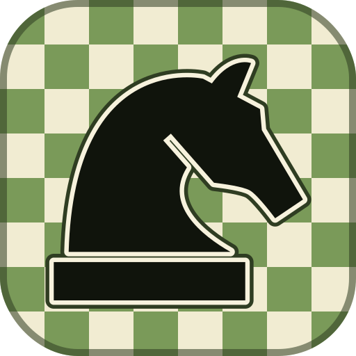

<p align="center">
  
</p>

<h1 align="center">ChessVision</h1>

<p align="center">
  <strong>See the board. Get the move.</strong><br>
  A local, screen-watching chess coach for Linux.
</p>

<p align="center">
  
</p>

ChessVision watches a chessboard on your screen, recognises the position, and shows
Stockfish's best move for the side you play — on the board, in SAN, with the
evaluation. Everything runs locally: no account, no cloud engine, no browser
extension.

**Status:** Linux (GNOME Wayland tested) · local Stockfish · offline by default.
Windows and macOS are planned; see [PLAN.md](PLAN.md).

## Contents

- [Features](#features)
- [How it works](#how-it-works)
- [Requirements](#requirements)
- [Install](#install)
- [Quick start](#quick-start)
- [Controls](#controls)
- [Options](#options)
- [Themes and assets](#themes-and-assets)
- [Configuration](#configuration)
- [Troubleshooting](#troubleshooting)
- [CLI mode](#cli-mode)
- [Self-test](#self-test)
- [Project layout](#project-layout)
- [Limitations](#limitations)
- [Roadmap](#roadmap)
- [Credits](#credits)
- [Fair play](#fair-play)

## Features

- **Your side, every time.** The suggestion is always for the side you play. The
  side changes only with `--side` or the `s` key — never on its own.
- **Reads pixels, not APIs.** No browser extension, site login, or DOM access. If
  the board is visible, ChessVision can watch it.
- **Theme-aware recognition.** Build templates from the exact board and piece PNGs
  in `assets/`, or calibrate from a screenshot if you do not know the theme names.
  Asset mode knows every piece's colour on both square colours.
- **Keeps up with the game.** It follows legal moves, tolerates a couple of misread
  squares, handles a flipped board after calibration, and ignores last-move tints.
- **No share dialog on GNOME.** It uses the compositor's ScreenCast API first and
  falls back to the XDG ScreenCast portal on other desktops.
- **Compact always-on-top window.** The board with a green arrow, the move in SAN,
  the evaluation or mate distance, adjustable Stockfish strength, and a theme picker
  with a live preview.
- **Offline self-test.** Synthetic boards across many themes, tracker scenarios,
  flip detection, auto-detection, and a mate-in-one — all without a screen share.

## How it works

1. **Capture.** On GNOME, ChessVision opens a PipeWire stream through Mutter's
   ScreenCast API and records the first monitor. Other desktops go through the XDG
   ScreenCast portal (pick a screen or a browser window). Captures are BGR frames.
2. **Recognise.** The calibrated board area is resized to 640×640 and split into 64
   cells. Each cell is high-pass filtered and correlated against the theme templates;
   an occupancy check and a fill-brightness tie-break separate empty squares and
   piece colours. Tinted last-move squares are classified by shape alone.
3. **Track.** The read is compared with the tracked position. An exact legal move is
   accepted; a close move is accepted if the landing square is visible and at most
   two squares disagree. An unreadable stable position is rebuilt after about three
   seconds, trying both board orientations.
4. **Analyse.** The position is sent to a local UCI engine (Stockfish by default) for
   a fixed thinking time. The score is always shown from your side's point of view.
5. **Show.** The live board is drawn with from/to highlights and an arrow, plus the
   move in SAN and the evaluation or mate distance. The window parks itself to the
   right of the board so a monitor capture does not see it.

## Requirements

ChessVision currently targets **Linux**. It was developed and tested on GNOME 48
Wayland; X11 and other desktops work through the XDG ScreenCast portal.

- **Python 3.10+** (tested with 3.13)
- **System packages:** PyGObject, GStreamer with `pipewiresrc`, Tkinter, OpenCV,
  NumPy, and Stockfish. On GNOME also `xdg-desktop-portal-gnome`.
- **Python packages:** `python-chess` and Pillow (in `requirements.txt`).
- **Assets:** the bundled `assets/boards` and `assets/pieces` images.
- **A local chess engine:** Stockfish 17 is expected in `PATH`,
  `~/.local/bin/stockfish`, or `./stockfish`, or pass `--engine`.
- **A capture source:** a monitor or a browser window showing the board.

Windows and macOS are not supported yet. The cross-platform capture, packaging, and
engine-bundling plan is in [PLAN.md](PLAN.md).

## Install

### Debian / Ubuntu

```bash
sudo apt install python3-gi gstreamer1.0-pipewire xdg-desktop-portal-gnome \
                 python3-opencv python3-numpy python3-tk stockfish
```

Then create a virtual environment that can see the system PyGObject/OpenCV packages:

```bash
git clone https://github.com/WalkTheEarth/chessvision.git
cd chessvision
python3 -m venv --system-site-packages .venv
.venv/bin/pip install -r requirements.txt
```

The `--system-site-packages` flag matters: `gi`, GStreamer, OpenCV, NumPy, and Tk
come from the distribution, while `python-chess` and Pillow come from the venv.

### Other Linux distributions

Install the equivalents of the packages above (GTK/PyGObject, GStreamer with the
PipeWire plugin, OpenCV, NumPy, Tkinter, Stockfish), create a
`--system-site-packages` venv, and install `requirements.txt`. If the screen-share
portal is missing, the GNOME Mutter path may still work; otherwise install your
desktop's XDG portal backend.

### Engine

If `stockfish` is not on `PATH`, point ChessVision at it:

```bash
.venv/bin/python chessvision.py --engine /path/to/stockfish
```

`$STOCKFISH` is also honoured. The engine is started only after the board area is
known, so a missing engine fails before any capture prompt.

## Quick start

On this machine, after the first calibration, the usual run is just:

```bash
cd /home/walktheearth/chessvision
.venv/bin/python chessvision.py
```

For a fresh setup, pick a theme pair from `assets/`:

```bash
ls assets/boards
ls assets/pieces
.venv/bin/python chessvision.py --side white --pieces classic --board brown
```

On the first run (or after `--recalibrate`):

1. On GNOME no share dialog appears; ChessVision captures the first monitor. On
   other desktops, choose the **browser window** with the chessboard (recommended)
   or the screen.
2. Drag a box around exactly the **64 squares** in the app, inside any border or
   coordinates, then click **Use board**.
3. Asset mode checks your piece set against the live screen and switches to a
   clearly better-fitting set automatically. The window then parks itself to the
   right of the board. On a narrow screen, move it clear of the board.
4. The side, theme, board area, and capture size are remembered. Later runs need no
   flags.

If you do not know the theme names, use `--screenshot` and keep the board at the
starting position for calibration. You can switch themes later with **Change** in
the app — a live preview is included — without restarting.

If the site flips the board after calibration, press `f` (or let the automatic
resync try both orientations). If the capture source or size changes, press
**Recalibrate**.

## Controls

| Control | What it does |
| --- | --- |
| **Board view** | The live board with the suggested move arrow and from/to highlights. The footer says whose move it is. |
| **YOU PLAY White / Black** | Your fixed side. The suggestion is always yours. |
| **STOCKFISH − 20 +** | Skill Level 0–20 (20 = full strength). Saved. |
| **Flip board** | Reorient the view if the site shows the board from the other side. |
| **Resync** | Re-read the position from the screen. |
| **Recalibrate** | Re-select the 64 squares and rebuild the templates. |
| **Change** | Opens the theme picker. **Match screen** reads the board and piece set from the screen; **Apply** checks the choice and warns if it does not match (press Apply again to force). |
| **Keep window on top** | Pin the coach above other windows. |
| **Quit** | Exit. |

Keyboard shortcuts:

| Key | Action |
| --- | --- |
| `q` | Quit |
| `s` | Switch side |
| `f` | Flip the board |
| `r` | Resync |
| `[` / `]` | Lower / raise Stockfish skill |
| `d` | Save a debug snapshot (`debug_*.png` + `.txt`, including the tracked FEN) |
| `e` | A small fish secret |

The status card shows `YOUR MOVE`, `WAITING FOR WHITE/BLACK…`, `THINKING…`,
`READING BOARD…`, checkmate/draw, `BOARD READ LOOKS WRONG`, or `SCREEN CHANGED`.
`BOARD READ LOOKS WRONG` means the screen and the tracked position disagree at the
suggested move's squares — press `f` or `r`, or check the theme.

## Options

All flags are optional. Flags marked *remembered* are written to `config.json`.

| Flag | Default | Meaning |
| --- | --- | --- |
| `--side white\|black` | last used, else `white` | Side you play. Remembered. |
| `--pieces NAME` | last used | Piece folder under `assets/pieces`. Remembered. |
| `--board NAME` | last used | Board PNG under `assets/boards` (without `.png`). Remembered. |
| `--bottom white\|black` | last used, else your side | Side at the bottom of the board. Remembered. |
| `--screenshot` | off | Ignore the asset theme and build templates from a starting-position screenshot. |
| `--assets DIR` | `./assets` | Alternative assets folder. |
| `--skill 0-20` | last used, else `20` | Stockfish Skill Level. Remembered. |
| `--engine PATH` | auto-detected | UCI engine. Searches `--engine`, `$STOCKFISH`, `PATH`, `~/.local/bin/stockfish`, `./stockfish`. |
| `--think SECONDS` | `1.0` | Engine thinking time per position. |
| `--threshold 0.6` | `0.6` | Raise if a square is falsely read as a piece; lower if pieces are missed. |
| `--recalibrate` | off | Re-select the board area (and rebuild asset templates if a theme is set). |
| `--cli` | off | Terminal/OpenCV mode instead of the GUI. Same flags and calibration. |

`--side` and `--pieces`/`--board` are remembered. Passing a side overrides the saved
one; the app never infers or changes your side by itself.

## Themes and assets

Assets come from
[GiorgioMegrelli/chess.com-boards-and-pieces](https://github.com/GiorgioMegrelli/chess.com-boards-and-pieces)
(v2.x). `assets/README.md` has the details.

- **Asset mode (recommended).** Build templates from the exact board and piece
  images. It knows both piece colours on both square colours and does not need a
  screenshot. Pass a pair, use the GUI **Change** dialog, or let calibration
  auto-detect the piece set.
- **Screenshot mode.** `--screenshot` builds templates from one screenshot of the
  starting position. It is the fallback when you do not know the theme names. 3D
  sets can drift; asset mode is better for 3D.
- **Low-contrast themes** (for example newsprint pieces on a newsprint board) are
  the hardest. If colours are confused, use asset mode with the exact names.
- **Coordinates.** ChessVision crops 15% from each cell edge, which drops thin grid
  lines and coordinates drawn inside the edge squares. Turning coordinates off in
  the site settings also helps.

## Configuration

State lives next to the script and is **not** committed:

| File | Contents |
| --- | --- |
| `config.json` | `roi` (x, y, w, h as fractions of the capture), `side`, `bottom`, `skill`, `pieces`, `board`, `frame_size` |
| `templates.npz` | The calibrated recognition templates |
| `debug_*.png` / `.txt` | Snapshots written by `d` |

To reset the board area, press **Recalibrate** in the app or delete `config.json` and
`templates.npz` while the app is closed. To reset a theme, choose a new pair with
**Change** or pass `--pieces` and `--board`.

The GUI writes `config.json` whenever you change side, skill, theme, board area, or
capture size. The CLI uses the same file.

## Troubleshooting

| Symptom | What to do |
| --- | --- |
| `SCREEN CHANGED` | The capture source or size changed. Press **Recalibrate**. |
| `BOARD READ LOOKS WRONG`, `CANNOT RESYNC`, or impossible moves | Usually the theme does not match the live screen. Open **Change**, compare “YOUR SCREEN” with “TEMPLATE PREVIEW”, press **Match screen**, then **Apply**. If the live preview is not a chessboard, press **Recalibrate**. |
| Pieces are missed or colours are confused | Use asset mode with the exact theme names; try a higher/lower `--threshold`; very low-contrast themes are the hardest. |
| `Stockfish not found` | Install Stockfish or pass `--engine /path/to/stockfish`. |
| No share dialog on GNOME | Expected: the app uses the compositor's ScreenCast API. If capture itself fails, check `xdg-desktop-portal-gnome` and `xdg-desktop-portal` (the fallback), then log out and back in. |
| The coach covers the board | It parks itself right of the board when there is room. On a narrow screen, move it clear or share the browser window instead of the screen. |
| Screenshot calibration fails | Put the board at the starting position; use asset mode if you know the theme. |
| Castling rights were lost | A rebuild from a mid-game position cannot see castling rights, so they are dropped rather than guessing an illegal castle. |
| The side changed | It does not change on its own. Press `s`/use **YOU PLAY**, or pass `--side`. |

Press `d` to save a snapshot if you want help diagnosing a read. The `.txt` includes
the tracked FEN and the current square classification.

## CLI mode

```bash
.venv/bin/python chessvision.py --cli
```

The terminal/OpenCV mode uses the same capture, recognition, tracking, and engine
code with a simple window. It is useful for debugging, a headless session, or when
Tk is unavailable. It supports the same flags and calibration prompts.

## Self-test

```bash
.venv/bin/python selftest.py
.venv/bin/python selftest.py /path/to/chess.com-boards-and-pieces
```

The offline test needs no screen capture or engine. It checks:

- five asset-built themes (including 3D and 8-bit) and six screenshot-calibrated
  themes;
- 9,536 synthetic cells with the expected 100% cell accuracy;
- castling and en-passant tracking, single-square misread recovery, flip detection,
  promoted queens on off-colour squares, piece-set and board auto-detection, and a
  mate-in-one from both sides' point of view.

It exits non-zero on any error. Run it after changing recognition or tracking code.

## Project layout

```
chessvision.py     Core: capture, recognition, tracking, engine, CLI
gui.py             Tk GUI and theme picker
selftest.py        Offline recognition/tracker tests
assets/            Board and piece PNGs
icon/              App icon (SVG source + PNG)
docs/              Screenshots
config.json        Local calibration (ignored)
templates.npz      Local recognition templates (ignored)
PLAN.md            Roadmap and cross-platform plan
```

## Limitations

- **Linux only today.** Windows and macOS are planned in [PLAN.md](PLAN.md).
- **One monitor.** On GNOME the app records the first monitor. Multi-monitor
  selection is on the roadmap; for now, use a single-monitor layout or the portal
  window-share fallback.
- **The board must stay visible.** ChessVision reads the screen; the coach window
  must not cover the board. It parks itself to the right when there is room.
- **Fixed side.** The side never changes by itself; only `--side` or `s`.
- **Pixel-level reading.** Animations, tooltips, popups, or a piece mid-drag can
  produce a bad frame; the tracker recovers, but a moment of confusion is possible.
- **Mid-game rebuilds drop castling rights** and infer the side to move.
- **Not every theme is equal.** Very low-contrast or unusual 3D themes may need
  asset mode or screenshot calibration.

## Roadmap

The next steps are cross-platform capture and packaging (Windows Graphics Capture,
macOS ScreenCaptureKit), auto board detection, a click-through overlay, and better
analysis (multi-PV, threats, eval graph). See [PLAN.md](PLAN.md) for the full plan,
priorities, milestones, and acceptance criteria.

## Credits

- Board and piece PNGs:
  [GiorgioMegrelli/chess.com-boards-and-pieces](https://github.com/GiorgioMegrelli/chess.com-boards-and-pieces)
  (v2.x). See `assets/README.md`.
- Knight icon: [SVG Repo](https://www.svgrepo.com/). The checkerboard background and
  the combined icon were made for this project.
- Engine: [Stockfish](https://stockfishchess.org/).
- Libraries: [python-chess](https://python-chess.readthedocs.io/), OpenCV, NumPy,
  PyGObject/GStreamer, Pillow, Tk.

## Fair play

ChessVision is a personal analysis and hint tool. Use it only where computer
assistance is allowed — for your own study, puzzles, unrated games, or positions you
have permission to analyse. Do not use it in rated online games or anywhere the
site's rules forbid engine assistance. You are responsible for how you use it.
