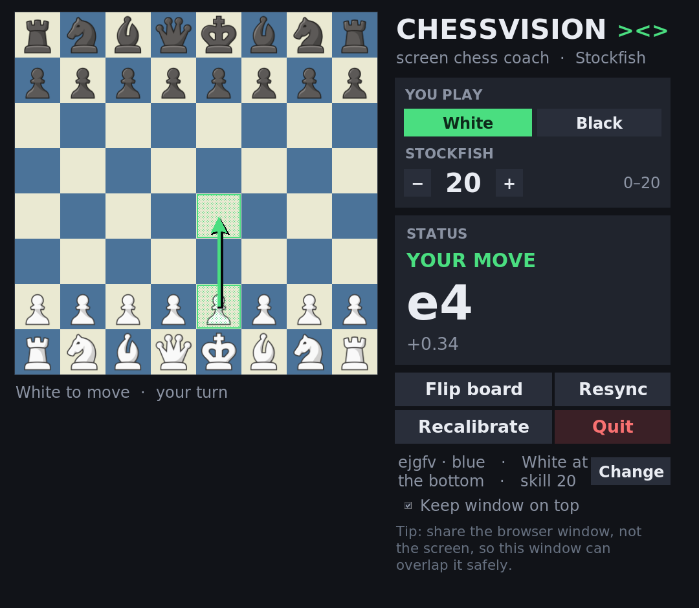

# ChessVision



A desktop coach for the chessboard on your screen. It watches the board, recognises
the pieces, and shows Stockfish's best move for **your** side in a compact
always-on-top window: the board with a green arrow, the move in SAN, and the
evaluation or mate distance.

- Your side is fixed. It changes only with `--side` or the `s` key — never on its own.
- Best results come from **asset mode**: templates built from the exact board/piece
  images in `assets/` (`--pieces`, `--board`, or the in-app **Change** dialog with a
  live preview). No colour guessing.
- Screenshot calibration is the fallback when you do not know the theme names.
- Automatic resync and board-flip handling, a suggestion sanity guard, adjustable
  Stockfish strength, and an offline self-test.

## Requirements

Linux with the XDG ScreenCast portal (tested on GNOME 48 Wayland; X11 works through
the same portal). On this machine everything is already installed:

- `python3-gi`, GStreamer with `pipewiresrc`, `xdg-desktop-portal-gnome`
- OpenCV, NumPy, Tkinter
- `python-chess` and Pillow in `.venv`
- Stockfish 17 at `~/.local/bin/stockfish`
- Board/piece PNGs in `assets/boards` and `assets/pieces` (bundled from
  [GiorgioMegrelli/chess.com-boards-and-pieces](https://github.com/GiorgioMegrelli/chess.com-boards-and-pieces), v2.x)

On another Debian/Ubuntu machine:

```bash
sudo apt install python3-gi gstreamer1.0-pipewire xdg-desktop-portal-gnome \
                 python3-opencv python3-numpy python3-tk stockfish
python3 -m venv --system-site-packages .venv
.venv/bin/pip install python-chess pillow
```

## Start

```bash
cd /home/walktheearth/chessvision
.venv/bin/python chessvision.py --side white --pieces ejgfv --board blue
```

On the first run (or after `--recalibrate`) the app asks for the board area:

1. GNOME asks what to share. Pick the **browser window** with the chessboard
   (recommended — then this app can overlap it safely) or the **screen**.
2. Drag a box around exactly the **64 squares** in the app, then click **Use board**.
   Asset mode checks your chosen piece set against the live screen and switches to a
   clearly better-fitting set automatically. The board can be at any position.
3. The share size and theme are remembered, so later runs are just:

```bash
.venv/bin/python chessvision.py
```

`ls assets/boards assets/pieces` lists the theme names. Once a theme is chosen it is
remembered; `--recalibrate` only re-selects the board area. You can switch themes any
time with **Change** in the app (preview included) — no restart required.

If you change what you share (window ↔ screen) or resize it, the capture size changes
and the app asks you to recalibrate. The screenshot fallback (`--screenshot`) requires
the board to be at the starting position.

## Controls

- **Board view** — the live board with the suggested move arrow and from/to
  highlights. The footer says whose move it is.
- **YOU PLAY White / Black** — your fixed side; the suggestion is always yours.
- **STOCKFISH − 20 +** — Skill Level 0–20 (20 = full strength). Saved.
- **Flip board** — if chess.com shows the board from the other side.
- **Resync** — re-read the position from the screen.
- **Recalibrate** — re-select the 64 squares (and re-check the piece set).
- **Change** (next to the theme line) — shows **your live screen** next to the
  template preview. **Match screen** reads the board and piece set from the screen;
  **Apply** checks the choice and warns if it does not match (click Apply again to
  force). Applying rebuilds the templates and remembers the theme.
- **Quit**.
- Keys: `q` quit, `s` switch side, `f` flip board, `r` resync, `[` / `]` strength,
  `d` save a debug snapshot, `e` a secret.

The status card shows `YOUR MOVE`, `WAITING FOR WHITE/BLACK…`, `THINKING…`,
`READING BOARD…`, checkmate/draw, or `BOARD READ LOOKS WRONG` when the screen and the
tracked position disagree at the suggested move's squares (press `f` or `r`). The
tracker tolerates one misread square; after ~3 unreadable seconds it rebuilds, trying
both board orientations and keeping the turn/castling rights when only the board
flipped.

## Options

```bash
--side white     # or black; remembered
--pieces NAME    # piece folder in assets/pieces; remembered
--board NAME     # board PNG in assets/boards; remembered
--bottom white   # side at the bottom (default: saved, else your side)
--screenshot     # ignore the asset theme and use screenshot templates
--assets DIR     # different asset folder (default: ./assets)
--skill 20       # Stockfish Skill Level 0-20; remembered
--engine PATH    # UCI engine, default: stockfish from PATH / ~/.local/bin
--think 1.0      # seconds of engine thinking per position
--threshold 0.6  # raise if a square is falsely read as a piece, lower if pieces are missed
--recalibrate    # redo the board selection (and asset templates if a theme is set)
--cli            # terminal/OpenCV mode instead of the GUI
```

`--cli` is the original terminal loop, useful for debugging or a headless session. It
supports the same flags and calibration.

## Offline self-test

```bash
.venv/bin/python selftest.py             # uses ./assets
.venv/bin/python selftest.py /path/to/chess.com-boards-and-pieces
```

It checks five asset-built themes (including 3D and 8-bit) plus six
screenshot-calibrated themes, castling/en-passant tracking, single-square misread
recovery, flip detection, promoted queens on off-colour squares, piece-set and board auto-detection, a mate-in-1 from both sides' point of view, and
exits non-zero on any error.

## Secrets (spoilers)

- En passant is greeted properly: `Holy hell, en passant!`
- Castling and underpromotions get their own notes in the status.
- Checkmate gets `GG`, a mate in one gets a fish (`><>`).
- Press `e` for a fish in the header. Press it again to remove it.

## Limitations and troubleshooting

- The side never changes by itself. Only `--side` or `s` changes it.
- If the capture source or size changed, the app says `SCREEN CHANGED` — press
  Recalibrate. Sharing a window (not the screen) means the app can overlap it.
- `BOARD READ LOOKS WRONG` / `CANNOT RESYNC`: usually the theme does not match the
  live screen. Open **Change**; compare “YOUR SCREEN” with “TEMPLATE PREVIEW”; press
  **Match screen** and Apply. If the live preview does not look like a chessboard,
  press **Recalibrate** (the board area is stale). Press `d` to save a debug snapshot
  (`debug_*.png`/`.txt`) if you want help diagnosing it.
- Colour confusion or impossible moves: use asset mode with the exact theme names.
  Asset templates know every piece's colour on both square colours. The calibration
  auto-detects the piece set from the live screen.
- Very low-contrast themes (newsprint pieces on the newsprint board) are the hardest.
- Screenshot-calibrated 3D sets can drift; asset mode is better for 3D.
- A rebuild from a mid-game position cannot know castling rights, so they are dropped
  (it will not suggest an illegal castle), and the side to move is inferred.
- `Stockfish not found`: install it or pass `--engine /path/to/stockfish`.
- No share dialog: install/restart `xdg-desktop-portal-gnome` and
  `xdg-desktop-portal`, then log out and back in.
- Coordinates drawn inside the edge squares are cropped by the 15% cell margin;
  turning coordinates off in chess.com also helps.
- The screen is only shared while the program runs; GNOME shows the sharing indicator.

This is a personal analysis/hint tool. Use it only where computer assistance is
allowed.
